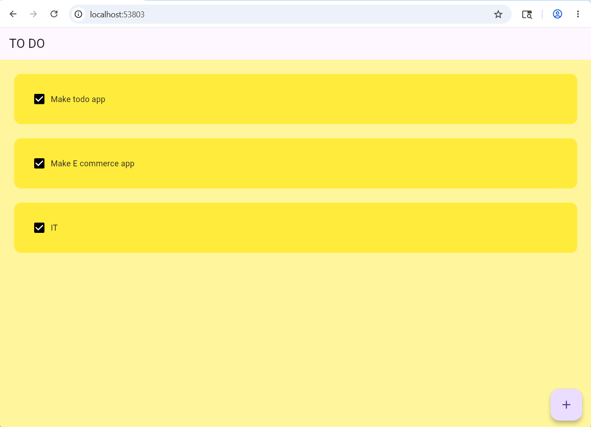

# Flutter Todo App 

This is a simple Todo App built with Flutter as part of my Flutter learning journey.

The app allows users to:
- Add new tasks
- Mark tasks as completed
- Store tasks locally using Hive database
- Practice Flutter UI, state management, and reusable widgets

## Features

- Dynamic task creation
- Checkbox task completion
- Custom dialog box
- Local storage with Hive
- Clean Flutter UI

## Technologies Used

- Flutter
- Dart
- Hive Database

## Project Structure

```bash
lib/
 ├── data/
 ├── pages/
 ├── util/
 └── main.dart
```

## Screenshot



## What I Learned

Through this project, I practiced:
- Stateful widgets
- Flutter layouts
- TextEditingController
- Dialogs and popups
- ListView.builder
- Local database integration using Hive
- Reusable Flutter components

## Getting Started

Clone the repository:

```bash
git clone https://github.com/simakelvinpeter/todo.git
```

Run the project:

```bash
flutter pub get
flutter run
```

## Author

Sima Kelvin Peter

GitHub:
https://github.com/simakelvinpeter
## Finished local app behavior

Tasks are saved to Hive when added, completed or deleted, and restored after reopening. Blank tasks cannot be saved. Storage failures show a message rather than pretending a save succeeded. The original yellow design is retained.

Run `flutter analyze` and `flutter test`. This is a single-device learning app; it does not require a backend or sign-in.
